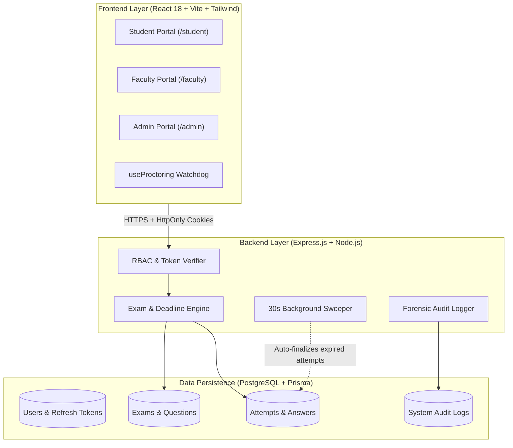
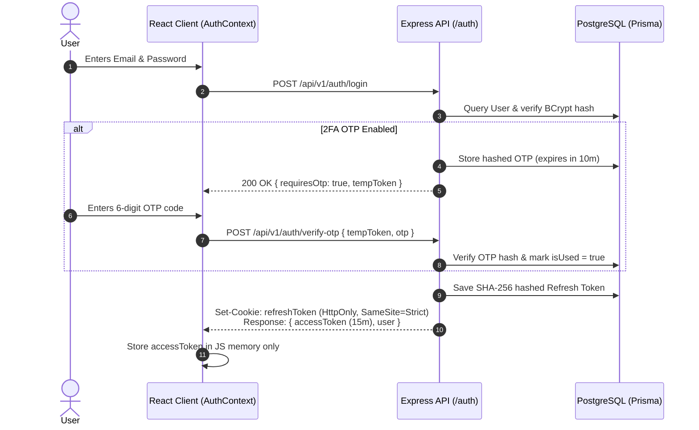
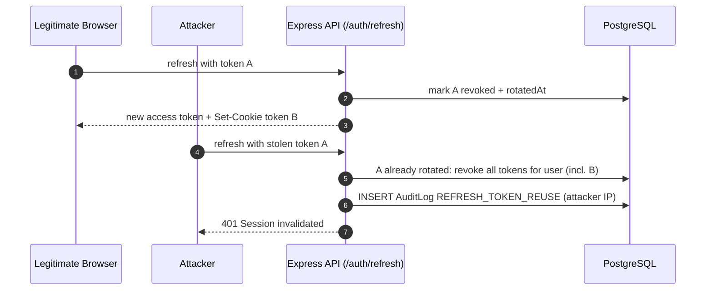
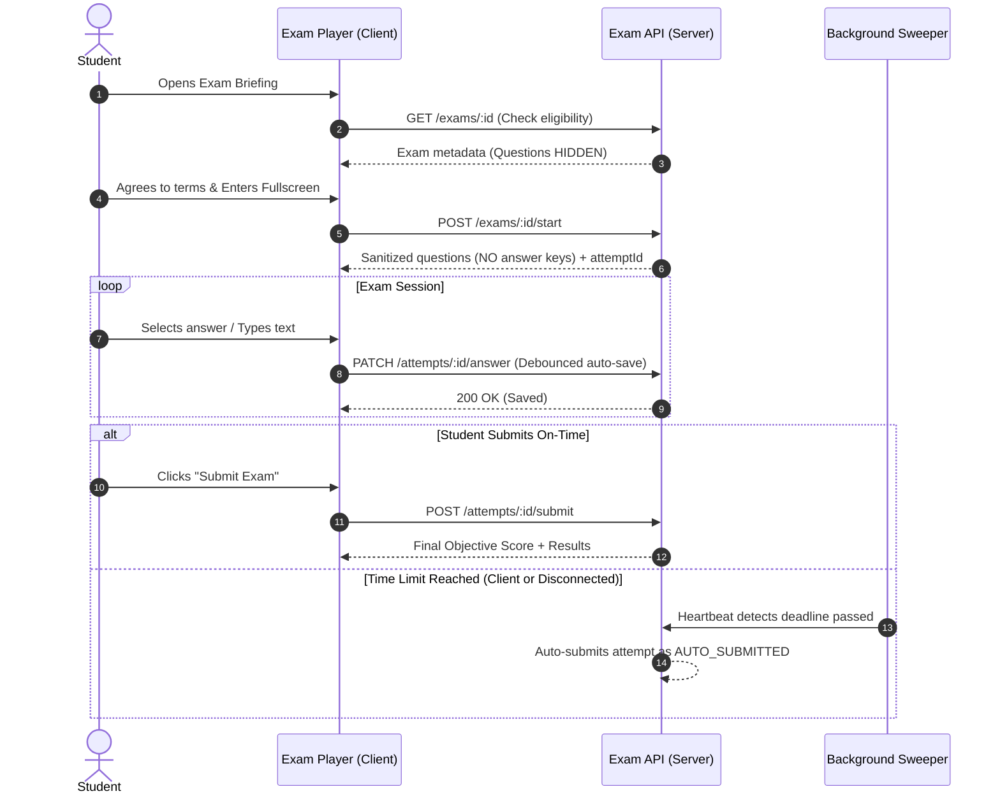
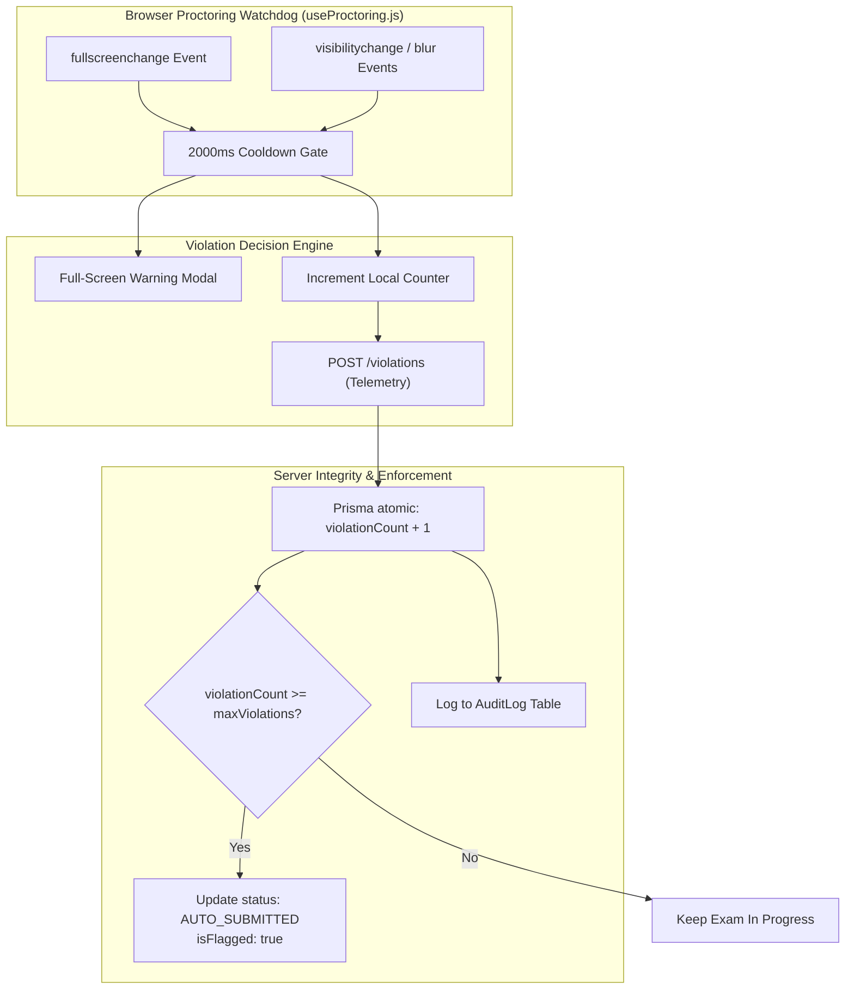
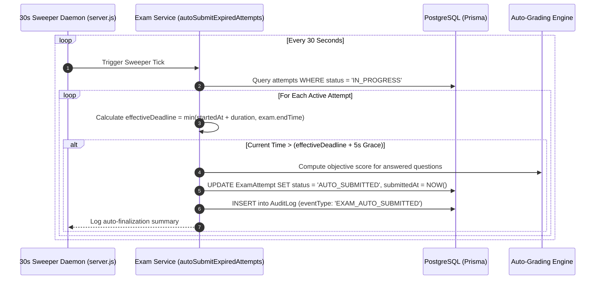
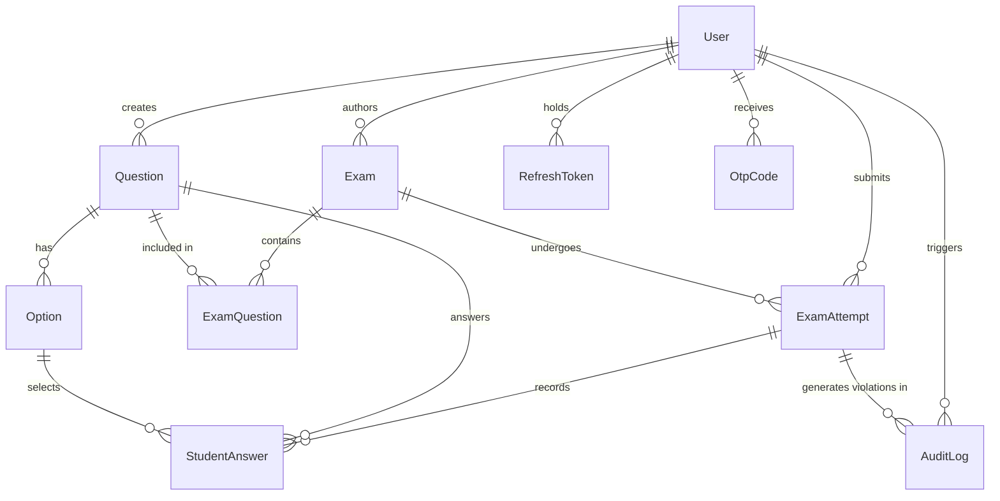

# ExamShield — Comprehensive System & Implementation Blueprint 🛡️

> **Platform Overview:** ExamShield is an enterprise-grade, highly resilient proctored examination platform designed for universities and certification bodies. It delivers a distraction-free examination experience for students, comprehensive question authoring and forensic evaluation tools for faculty, and governance controls for administrators.

---

## 📑 Table of Contents

1. [Architecture & System Design](#1-architecture--system-design)
2. [Authentication & Security Engine](#2-authentication--security-engine)
3. [Student Examination Experience](#3-student-examination-experience)
4. [Proctoring & Anti-Cheat Watchdog](#4-proctoring--anti-cheat-watchdog)
5. [Automatic Deadline Sweeper Daemon](#5-automatic-deadline-sweeper-daemon)
6. [Faculty Authoring & Evaluation Suite](#6-faculty-authoring--evaluation-suite)
7. [Administrator Governance & Audit Engine](#7-administrator-governance--audit-engine)
8. [Database Schema & Entity Relationships](#8-database-schema--entity-relationships)
9. [Engineering Implementation Matrix (Feature-by-Feature)](#9-engineering-implementation-matrix)

---

## 1. Architecture & System Design

ExamShield operates on a decoupled client-server architecture with an uncompromising zero-trust security perimeter.



### Technical Stack
* **Frontend:** React 18, Vite, React Router v6, Tailwind CSS (minimalist dark Zinc theme), Lucide Icons.
* **Backend:** Node.js, Express.js, Prisma ORM, Zod Schema Validation.
* **Database:** PostgreSQL with relational integrity, foreign keys, and unique composite constraints.
* **Security Standards:** HttpOnly/SameSite cookies, SHA-256 token hashing, BCrypt password hashing (12 rounds).

---

## 2. Authentication & Security Engine

### Feature Objective
Provide secure, non-forgeable, role-gated session management with two-factor authentication, ensuring complete immunity against Cross-Site Scripting (XSS) and Cross-Site Request Forgery (CSRF).

### Technical Implementation



#### 1. In-Memory Access Token + HttpOnly Refresh Token
* **Implementation:** 
  * Access tokens expire in 15 minutes and are kept **in memory** via React `AuthContext` state. They are never written to `localStorage` or `sessionStorage`.
  * Refresh tokens expire in 7 days and are set as an `HttpOnly` cookie using the options in `server/src/config/security.js`: `{ httpOnly: true, secure: NODE_ENV === 'production', sameSite: NODE_ENV === 'production' ? 'strict' : 'lax', maxAge: 7 days }`. JavaScript can never read the cookie, and in production it is only sent over HTTPS and never on cross-site requests.
  * The database stores only the `SHA-256` hash of the refresh token (`prisma.refreshToken.create({ data: { tokenHash: sha256(token) } })`), ensuring database leaks do not expose reusable sessions. Each token carries a random `jwtid`, so two tokens issued in the same second are still distinct.

#### 2. Refresh Token Rotation & Reuse Detection (`authService.refreshSession`)
* **Rotation:** Every call to `POST /auth/refresh` retires the presented refresh token (`isRevoked = true`, `rotatedAt = now`) and issues a brand-new access + refresh token pair; the new refresh token replaces the cookie. A refresh token is therefore single-use, and an active session slides forward 7 days from its last refresh.
* **Reuse (theft) detection:** A rotated token should never be presented again. If one is, someone else holds a copy of it, so the server:
  1. revokes **every** active refresh token for that user (attacker and legitimate user are both logged out),
  2. writes a `REFRESH_TOKEN_REUSE` entry to the audit log with the presenting IP address,
  3. returns `401` asking the user to sign in again.
* **Concurrency grace window (10 seconds):** Two tabs, or React StrictMode in development, can refresh with the same cookie at the same moment. The token is claimed with an atomic conditional update (`updateMany({ where: { id, isRevoked: false } })`), so exactly one request rotates it. A request that loses the race, or presents the just-rotated token within 10 seconds, receives a short-lived access token only, never a new refresh token, so even a replay inside the window cannot obtain a lasting session.
* **Revoked vs. rotated:** Tokens revoked by logout, password change or account deactivation simply return `401` and do not trigger family revocation.



#### 3. Axios Request & Response Interceptors (`services/api.js`)
* **Request Interceptor:** Automatically attaches `Authorization: Bearer <inMemoryToken>` to every outbound API request.
* **Response Interceptor:** Detects `401 Unauthorized` responses on protected routes, pauses queued requests using a promise lock (`isRefreshing`), calls `POST /auth/refresh`, updates the in-memory token, and transparently replays the original requests.
* **Session-Expired Handling:** If the refresh itself is rejected (`401`/`403`: logged out elsewhere, password changed, account deactivated, or refresh token reuse detected), the interceptor notifies `AuthContext` via `setOnSessionExpired`. The user is cleared, route guards redirect to `/login`, and the login page shows "Your session has ended. Please sign in again." Network errors do not end the session.

#### 4. Administrative Account Provisioning (No Public Registration)
* **Implementation:** The `/api/v1/auth/register` endpoint is intentionally hard-coded to return `403 Forbidden`:
  ```javascript
  // server/src/routes/authRoutes.js
  router.post('/register', (req, res) => {
    return res.status(403).json({
      success: false,
      error: 'Public registration is disabled. User accounts must be provisioned by the institutional administrator.'
    });
  });
  ```
* All users (`STUDENT`, `FACULTY`, `ADMIN`) must be provisioned through the Administrator Dashboard via `adminService.createUser`.

---

## 3. Student Examination Experience

### Feature Objective
Provide students with a focused, low-latency, resilient exam interface that prevents answer loss during network hiccups, eliminates cheating via DevTools inspection, and provides instant evaluation feedback.



### Technical Implementation

#### 1. Zero-Leak Sanitization Engine (`examService.js -> startExam`)
* When an exam begins, questions are loaded from the database, but **all grading metadata is completely stripped** before serialization:
  ```javascript
  // Strips isCorrect so it cannot be inspected in Chrome DevTools Network Tab
  const sanitizedQuestions = attempt.exam.questions.map((eq, index) => ({
    id: eq.question.id,
    displayOrder: index + 1,
    subject: eq.question.subject,
    type: eq.question.type,
    text: eq.question.text,
    marks: eq.question.marks,
    // Returns only { id, text } per option (isCorrect is EXCLUDED from payload!),
    // shuffled per student for MCQ questions
    options: formatOptionsForStudent(eq.question, `${examId}-${userId}`),
    selectedOptionId: studentAnswerMap[eq.question.id]?.selectedOptionId || null,
    textAnswer: studentAnswerMap[eq.question.id]?.textAnswer || null
  }));
  ```

#### 2. Seeded Fisher-Yates Randomization
* **Question order:** Questions are shuffled per student using a deterministic, seeded Fisher-Yates shuffle (seed: `examId-studentId`). The resulting order is persisted in `StudentAnswer.displayOrder` (1 through N) when the attempt starts, so refreshing the browser keeps the same order while adjacent students see different sequences.
* **Option order (MCQ):** Answer options of each multiple-choice question are shuffled per student with the same algorithm (seed: `examId-studentId-questionId`, see `formatOptionsForStudent`). Options are sorted by `id` before shuffling because PostgreSQL does not guarantee row order, which keeps a student's option order stable across resumes. Because grading compares option IDs rather than positions, shuffling has no effect on scoring.
* **True/False** questions keep their natural "True, False" order, since shuffling two options adds little protection and confuses students.

#### 3. Real-Time Debounced Autosave (`ExamPlayer.jsx`)
* **Implementation:** Answer selections trigger local React state immediately for instantaneous UI responsiveness (`setAnswers(...)`).
* In the background, a per-question save queue dispatches `PATCH /api/v1/exams/:examId/attempts/:attemptId/answer`:
  * **Option clicks** are saved immediately; **typed short answers** are debounced and saved after 600ms without typing, so a sentence produces one request instead of one per keystroke.
  * **At most one request per question is in flight.** Changes made during a save are queued and sent when it finishes, always with the newest value, so out-of-order responses can never overwrite a newer answer with an older one.
  * **Failed saves are retried** with exponential backoff (2s, 4s, 8s, up to 15s) on network errors, `5xx` and `429`. Errors that retrying cannot fix (e.g. exam already submitted) are not retried.
* A status label reflects the queue: `Saving...`, `Saved`, `Not saved, retrying...` (amber) or `Save error` (red).
* **Submission never drops answers silently:** before submitting, all queued answers are sent and in-flight saves awaited. If any remain unsaved, submission is blocked and the confirmation dialog shows how many answers could not be saved. When the timer expires, queued answers are sent on a best-effort basis before the auto-submit.

#### 4. Monospace Countdown Timer Backed by Server Clock
* **Implementation:** The client timer does not run on arbitrary client clocks. Upon starting, the server returns `remainingSeconds = Math.max(0, Math.floor((effectiveDeadline - Date.now()) / 1000))`.
* A client `setInterval` decrements `remainingSeconds` every 1000ms.
* When `remainingSeconds <= 0`, the client automatically locks input fields and fires the submission routine.

---

## 4. Proctoring & Anti-Cheat Watchdog

### Feature Objective
Enforce strict digital exam integrity directly within the student's browser without requiring invasive third-party kernel software or browser extensions.



### Technical Implementation

#### 1. Browser Event Listeners (`useProctoring.js`)
* **Fullscreen Exit:** Attached to `document.addEventListener('fullscreenchange', ...)`:
  * If `!document.fullscreenElement`, the student has escaped fullscreen mode.
* **Tab / Window Switch:** Attached to `document.addEventListener('visibilitychange', ...)` and `window.addEventListener('blur', ...)`:
  * Triggers when the tab is hidden (`document.hidden === true`) or when focus shifts to another desktop application (e.g., Discord, ChatGPT, IDE).
* **Debounce Gate:** A 2000ms timestamp cooldown (`Date.now() - lastViolationTime < 2000`) prevents multiple alerts triggered by a single OS notification or momentary window resize.

#### 2. Atomic Server-Side Violation Counter (`examService.js -> recordViolation`)
* To prevent race conditions from concurrent rapid events, the backend uses PostgreSQL atomic increments:
  ```javascript
  const updatedAttempt = await prisma.examAttempt.update({
    where: { id: attemptId },
    data: {
      violationCount: { increment: 1 } // Atomic database-level increment
    }
  });

  // If threshold exceeded, terminate immediately
  if (updatedAttempt.violationCount >= exam.maxViolations) {
    return executeExamSubmission(attemptId, 'AUTO_SUBMITTED', true);
  }
  ```

#### 3. Forensic Audit Trail Attribution
* Every violation generates an append-only row in the `AuditLog` table (see [Append-Only Enforcement](#3-append-only-enforcement-database-trigger)) containing:
  * `userId`: Authenticated student ID
  * `attemptId`: Current exam session ID
  * `eventType`: `TAB_SWITCH`, `FULLSCREEN_EXIT` or `WINDOW_BLUR`
  * `details`: Human-readable context and elapsed duration
  * `ipAddress`: Client IPv4/IPv6 address
  * `timestamp`: Precise UTC timestamp

---

## 5. Automatic Deadline Sweeper Daemon

### Feature Objective
Guarantee that no student can ever submit an exam past the hard deadline, even if they disconnect their internet, close their browser, freeze their laptop clock, or abandon the session.

### Technical Implementation



#### 1. Background Sweeper Setup (`server.js`)
* Initialized upon Express server boot with an unref'd recurring interval:
  ```javascript
  // server/src/server.js
  const SWEEPER_INTERVAL_MS = 30 * 1000; // 30 seconds
  setInterval(async () => {
    try {
      await autoSubmitExpiredAttempts();
    } catch (err) {
      console.error('Sweeper error:', err);
    }
  }, SWEEPER_INTERVAL_MS);
  ```

#### 2. Deadline Math & Grace Buffer (`examService.js`)
* The exact deadline is computed mathematically:
  ```javascript
  const effectiveDeadline = Math.min(
    attempt.startedAt.getTime() + attempt.exam.durationMinutes * 60 * 1000,
    attempt.exam.endTime.getTime()
  );
  const GRACE_BUFFER_MS = 5000; // 5 seconds for network latency
  
  if (Date.now() > effectiveDeadline + GRACE_BUFFER_MS) {
    // Force auto-submission & grading
    await executeExamSubmission(attempt.id, 'AUTO_SUBMITTED', attempt.isFlagged);
  }
  ```

#### 3. Strict Enforcement in Manual Submissions (`submitExam`)
* If a student's client sends a manual `POST /submit` past the deadline, the server overrides the requested status and records it as `AUTO_SUBMITTED` with an audit notice, ensuring late submissions cannot be disguised as on-time.

---

## 6. Faculty Authoring & Evaluation Suite

### Feature Objective
Empower instructors with complete control over question design, assessment scheduling, and forensic evaluation with side-by-side question-key comparisons.

### Technical Implementation

#### 1. Question Bank Authoring (`/faculty/questions`)
* **Model Schema:** Questions support `MCQ`, `TRUE_FALSE`, and `SHORT_ANSWER`.
* **Live Student Preview Mode:** The authoring modal includes a real-time reactive preview pane. As the instructor types question text, options, and selects correct keys, the right-hand panel renders the exact student-facing component using the same CSS classes and typography.
* **Validation:** Enforces at least 2 options for MCQs, exactly 1 correct answer, non-empty prompts, and positive marks attribution via Zod schema (`createQuestionSchema`).

#### 2. Three-Step Assessment Wizard (`/faculty/exams`)
* **Step 1 (Metadata):** Title, subject, target batch (e.g. `CS-2026-A`), duration (minutes), max violations.
* **Step 2 (Scheduling):** Start and end datetime-local pickers. Validates that `startTime < endTime`.
* **Step 3 (Question Selector):** Displays the question bank with live mark summation:
  $$\text{Total Marks} = \sum_{i=1}^{n} \text{marks}(Q_i)$$
* **Publishing Lock:** Publishing an exam (`PATCH /exams/:id/publish`) changes status to `PUBLISHED`, locking the question set and activating visibility for the assigned student cohort.

#### 3. Submissions Dashboard (`/faculty/exams/:id/submissions`)
* Queries all attempts for the exam including student profiles:
  ```javascript
  const attempts = await prisma.examAttempt.findMany({
    where: { examId },
    include: {
      student: { select: { id: true, name: true, email: true, batch: true } }
    },
    orderBy: { startedAt: 'desc' }
  });
  ```
* Displays class performance metrics: Total Candidates, Evaluated Count, Flagged Violations Count, and Average Score.

#### 4. Candidate Audit Inspector Modal (`AttemptInspectorModal.jsx`)
* **Split Question Comparison:**
  * Iterates over `StudentAnswer` records linked to `Attempt`.
  * For each question, displays:
    * The question prompt and marks available.
    * The student's selected option highlighted in Green (if correct) or Red (if incorrect).
    * The instructor's official correct answer key.
    * Points awarded for that question.
* **Forensic Event Trail:** Displays all rows from `AuditLog` linked to `attemptId`, sorted chronologically, showing exact timestamps of tab switches, fullscreen escapes, and IP addresses.

---

## 7. Administrator Governance & Audit Engine

### Feature Objective
Provide institutional administrators with total governance over accounts, security policies, and an immutable trail of all platform activities.

### Technical Implementation

#### 1. User Management & Session Revocation (`/admin/users`)
* **Account Creation:** Provision accounts with specific roles (`STUDENT`, `FACULTY`, `ADMIN`) and batch tags.
* **Status Toggling:** When an admin toggles an account from active to deactivated:
  ```javascript
  // server/src/services/adminService.js
  await prisma.user.update({ where: { id: targetUserId }, data: { isActive: Boolean(isActive) } });

  if (!isActive) {
    await prisma.refreshToken.updateMany({
      where: { userId: targetUserId, isRevoked: false },
      data: { isRevoked: true }
    });
  }
  ```
  Revoking the refresh tokens ensures the user is ejected from active sessions on their next token refresh (at most 15 minutes, the access token lifetime). The change is recorded as a `USER_STATUS_CHANGE` audit event.
* **Self-Deactivation Guard:** Frontend and backend reject deactivation requests if `targetUserId === currentAdminId`.

#### 2. System Audit Log Explorer (`/admin/audit-logs`)
* **Centralized Security Stream:** Paginated queries (`limit`, `offset`) with event type filtering over the events the platform records:
  * `OTP_VERIFY`: successful two-factor sign-in
  * `TAB_SWITCH` / `FULLSCREEN_EXIT` / `WINDOW_BLUR`: proctoring violations
  * `AUTO_SUBMIT`: attempt finalized by time expiry, violation limit, late submission or the background sweeper (reason in `details`)
  * `USER_STATUS_CHANGE`: account activation/deactivation and password changes
  * `REFRESH_TOKEN_REUSE`: a rotated refresh token was replayed; all of the user's sessions were revoked
* **JSON Details Viewer:** Expandable accordion view parsing `details` payloads to display forensic event metadata.

#### 3. Append-Only Enforcement (Database Trigger)
* Audit rows can be inserted and read, but never changed or removed. This is enforced **inside PostgreSQL**, not just by the absence of an API endpoint (migration `20261005120000_audit_log_append_only`):
  ```sql
  CREATE TRIGGER "AuditLog_no_update_delete"
  BEFORE UPDATE OR DELETE ON "AuditLog"
  FOR EACH ROW EXECUTE FUNCTION audit_log_reject_modification();

  -- TRUNCATE bypasses row-level triggers, so it is blocked separately
  CREATE TRIGGER "AuditLog_no_truncate"
  BEFORE TRUNCATE ON "AuditLog"
  FOR EACH STATEMENT EXECUTE FUNCTION audit_log_reject_modification();
  ```
* Any `UPDATE`, `DELETE` or `TRUNCATE`, whether from the API, Prisma Studio or a raw SQL session, fails with `AuditLog is append-only: <operation> is not permitted`.
* **Consequence:** users and exam attempts that have audit history cannot be hard-deleted (the `ON DELETE SET NULL` cascade is itself an update). Accounts are deactivated instead, which is already the platform's design.
* **Limitation:** a database superuser or the table owner can still disable the trigger. A production deployment should connect the API as a dedicated role granted only `INSERT` and `SELECT` on `AuditLog`.

---

## 8. Database Schema & Entity Relationships



### Relational Table Definitions (Prisma)

| Table | Primary Key | Key Foreign Keys | Purpose |
| :--- | :--- | :--- | :--- |
| **`User`** | `id` (UUID) | - | User identities, BCrypt hashes, roles, batch cohorts |
| **`RefreshToken`**| `id` (UUID) | `userId` → `User.id` | SHA-256 hashed 7-day refresh tokens; `rotatedAt` marks single-use tokens already exchanged (reuse detection) |
| **`OtpCode`** | `id` (UUID) | `userId` → `User.id` | Hashed 6-digit 2FA codes with 10-minute expiry |
| **`Exam`** | `id` (UUID) | `createdById` → `User.id` | Assessment schedule, duration, batch, max violations |
| **`Question`** | `id` (UUID) | `createdBy` → `User.id` | Question bank items, formats, point weights |
| **`Option`** | `id` (UUID) | `questionId` → `Question.id` | Multiple-choice options with `isCorrect` flags |
| **`ExamQuestion`**| Composite (`examId`, `questionId`) | `examId`, `questionId` | Many-to-many join table between Exams and Questions |
| **`ExamAttempt`** | `id` (UUID) | `examId`, `studentId` | Attempt sessions, scores, status, violation counter |
| **`StudentAnswer`**| `id` (UUID) | `attemptId`, `questionId` | Student selections, text answers, display order |
| **`AuditLog`** | `id` (UUID) | `userId`, `attemptId` | Forensic event logs, IP addresses, incident timestamps; append-only via database trigger |

---

## 9. Engineering Implementation Matrix

This matrix provides a technical reference detailing how every major feature is implemented across the stack:

| Feature | Frontend Implementation | Backend API & Service | Database Mechanism | Security & Integrity Control |
| :--- | :--- | :--- | :--- | :--- |
| **Authentication & 2FA** | `Login.jsx`, `AuthContext.jsx` with in-memory token state | `POST /auth/login`<br/>`POST /auth/verify-otp`<br/>`authService.js` | `User`, `OtpCode`, `RefreshToken` | Access tokens in JS memory only; refresh token in `HttpOnly` cookie (`SameSite=Strict` + `Secure` in production) |
| **Refresh Token Rotation** | `services/api.js` interceptor (transparent to the user) | `POST /auth/refresh`<br/>`authService.refreshSession` | `RefreshToken.isRevoked`, `RefreshToken.rotatedAt` | Single-use refresh tokens; replaying a rotated token revokes all of the user's sessions and logs `REFRESH_TOKEN_REUSE` |
| **Public Registration Block** | N/A (Admin only) | `POST /auth/register`<br/>Returns explicit `403 Forbidden` | N/A | Fails closed; prevents unauthorized account creation |
| **Student Dashboard** | `StudentDashboard.jsx` with tabs for Available, Upcoming, Completed | `GET /exams`<br/>`examService.listExams` | `Exam` filtered by `targetBatch = user.batch` | Cohort isolation; students cannot see exams outside their batch |
| **Pre-Flight Briefing** | `ExamBriefing.jsx` with resolution and Fullscreen API checks | `GET /exams/:id`<br/>`examService.getExamById` | `Exam` joined with `createdById` | Questions remain completely hidden until explicit exam start |
| **Live Exam Player** | `ExamPlayer.jsx` with question palette grid and hotkeys | `POST /exams/:id/start`<br/>`examService.startExam` | `ExamAttempt`, `StudentAnswer` | Payload strips all `isCorrect` keys; seeded Fisher-Yates shuffling of question order and MCQ option order per student |
| **Debounced Autosave** | `ExamPlayer.jsx` per-question save queue (600ms typing debounce, one request in flight, retry with backoff) | `PATCH /attempts/:id/answer`<br/>`examService.saveAnswer` | `StudentAnswer` upsert on `(attemptId, questionId)` | Checks attempt status is `IN_PROGRESS` and deadline has not expired |
| **Anti-Cheat Watchdog** | `useProctoring.js` (`fullscreenchange`, `visibilitychange`, `blur`) | `POST /violations`<br/>`examService.recordViolation` | Atomic update: `violationCount: { increment: 1 }` | Auto-submits exam when `violationCount >= maxViolations`; logs client IP |
| **Automatic Deadline Sweeper** | N/A (Server background daemon) | `setInterval` in `server.js` calling `autoSubmitExpiredAttempts` | `ExamAttempt` status update to `AUTO_SUBMITTED` | Auto-finalizes expired attempts every 30s even if student is disconnected |
| **Exam Scorecard** | `ExamResult.jsx` with score breakdown & integrity badge | `GET /exams/:id/my-attempt`<br/>`examService.getMyAttempt` | `ExamAttempt` joined with `Exam` | IDOR prevention: verifies attempt belongs to authenticated student |
| **Question Bank Authoring** | `QuestionBank.jsx` with Live Student Preview pane | `POST /questions`<br/>`PATCH /questions/:id`<br/>`questionService.js` | `Question` joined with `Option` records | Zod validation ensures at least 2 options for MCQ and exactly 1 correct key |
| **3-Step Assessment Builder** | `ExamManager.jsx` wizard with live point tallying | `POST /exams`<br/>`PATCH /exams/:id/publish`<br/>`examService.createExam` | `Exam`, `ExamQuestion` join table | Publishing locks exam questions and enables student cohort access |
| **Class Submissions Review** | `ExamSubmissions.jsx` candidate table with metrics | `GET /exams/:id/attempts`<br/>`examService.getExamSubmissions` | `ExamAttempt` joined with `student` | Restricted to `FACULTY` author or `ADMIN` role |
| **Candidate Audit Inspector** | `AttemptInspectorModal.jsx` side-by-side comparison | `GET /attempts/:id`<br/>`examService.getAttemptDetails` | `StudentAnswer`, `Option`, `AuditLog` | Displays student selection vs official key and proctoring forensic logs |
| **User Management** | `UserManagement.jsx` with live status toggling | `GET /admin/users`<br/>`PATCH /users/:id/status`<br/>`adminService.js` | `User.isActive` update; revokes `RefreshToken` | Self-deactivation guard; revoking refresh tokens kills active sessions |
| **Audit Log Explorer** | `AuditLogExplorer.jsx` with event category filtering | `GET /admin/audit-logs`<br/>`adminService.getAuditLogs` | `AuditLog` table with IP, timestamp, details; PostgreSQL trigger blocks `UPDATE`/`DELETE`/`TRUNCATE` | Append-only forensic log of authentication, account, token-reuse and proctoring incidents |
